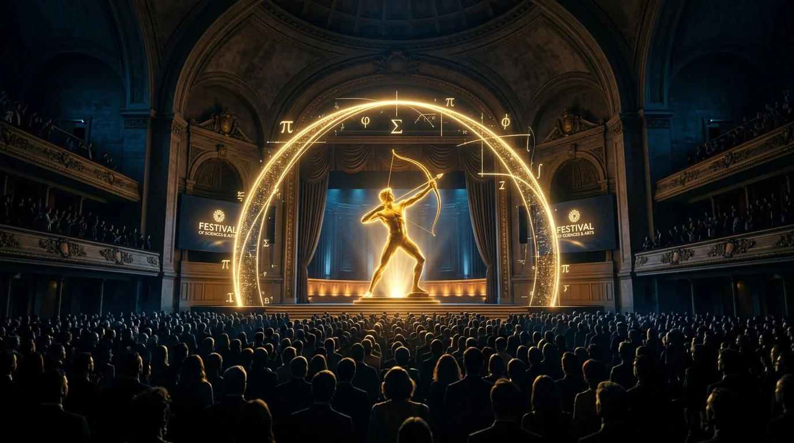

# ASTHRA ’26 — Mathematics Fest 🌌✨

> **St. Thomas College, Thrissur · Department of Mathematics**  
> *A Cinematic, 3D WebGL Mathematics Festival Experience*



---

## 🌟 Overview

**ASTHRA ’26** is the official annual mathematics festival organized by the Department of Mathematics at St. Thomas College, Thrissur. This web application delivers a photorealistic 3D WebGL solar eclipse hero section, luxury dark-editorial design system, seamless looping background video, interactive event timelines, live social drive metrics, and instant pass generation.

---

## ⚡ Tech Stack

- **Framework**: [React 19](https://react.dev/) + [Vite 6](https://vitejs.dev/) with `@vitejs/plugin-react-swc`
- **3D Graphics**: [Three.js](https://threejs.org/) (Photorealistic 3D beveled metallic ring with specular shine sweeps, pinpoint scintillating starfield & cosmic meteors)
- **Styling**: [TailwindCSS v4](https://tailwindcss.com/) + Custom Glassmorphism tokens
- **Icons & Effects**: [Lucide React](https://lucide.dev/), [Canvas Confetti](https://www.npmjs.com/package/canvas-confetti)

---

## 🚀 Getting Started

### Prerequisites
- Node.js (v18 or higher recommended)
- npm or pnpm or yarn

### Installation
```bash
# 1. Clone the repository
git clone https://github.com/Nitto26/asthra.git
cd asthra

# 2. Install dependencies
npm install

# 3. Start local development server
npm run dev
```

### Production Build
```bash
# Build optimized production bundle
npm run build

# Preview production build locally
npm run preview
```

---

## 📁 Project Structure

```text
asthra/
├── public/
│   └── assets/           # Static media assets (video, images, webp, logo)
├── src/
│   ├── components/       # Three.js Canvas, Navbar, Modals
│   ├── data/             # Festival events, social drive, site configuration
│   ├── sections/         # Hero, About, Events, Social Drive, Contact
│   ├── utils/            # Web Audio synthesizers & sound chimes
│   ├── App.jsx           # Main App layout & modal routing
│   ├── index.css         # Design tokens, fonts, animations
│   └── main.jsx          # Entry point
├── index.html
├── package.json
└── vite.config.js
```

---

## 🏛️ Event Highlights

1. **Inaugural Ceremony** — Grand keynote address & festival launch
2. **Infinite Quest** — Flagship Intercollegiate Mathematics Quiz
3. **Euler's Labyrinth** — Algorithmic Puzzle & Cryptography Arena
4. **Topology of Tomorrow** — Hands-on Computational Workshop
5. **Ramanujan's Trail** — Mathematical Campus Treasure Hunt
6. **Valedictory & Awards** — Prize distribution & gala celebration

---

## 📜 License
Created for **ASTHRA ’26 — Mathematics Fest**. All rights reserved.
